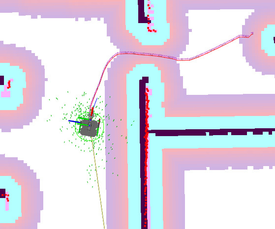
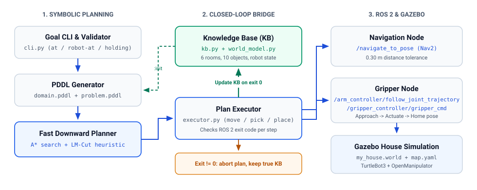
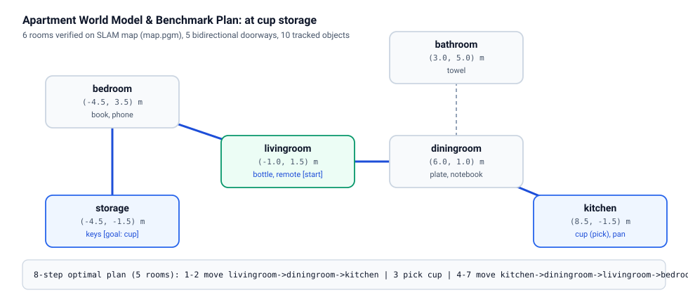
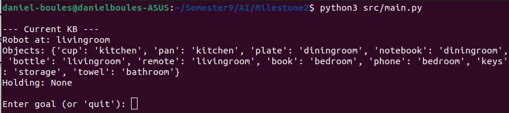
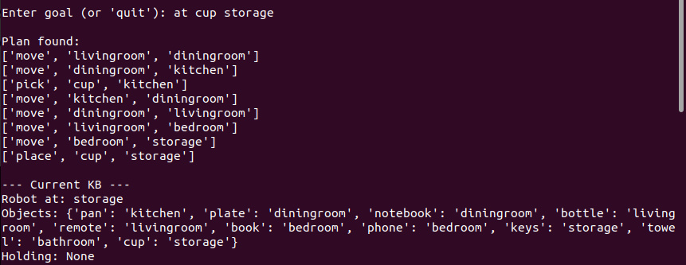
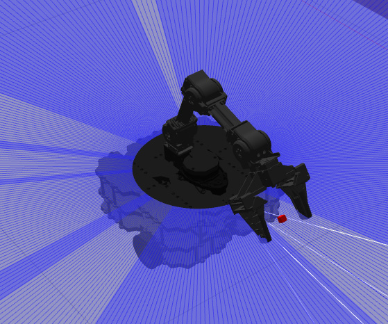
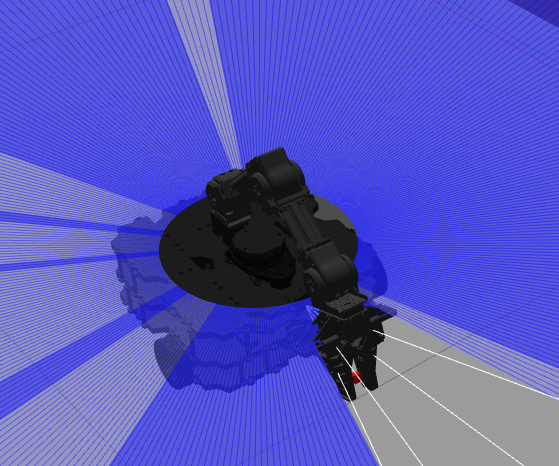
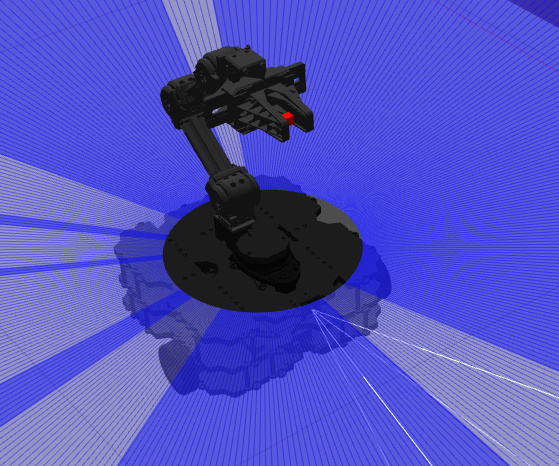

# TurtleBot3 AI Service Robot

PDDL task planner (Fast Downward A* + LM-Cut) integrated with ROS 2 Nav2 navigation and OpenManipulator pick-and-place on a TurtleBot3 in Gazebo.

[](https://github.com/andrew-abdelmalak/turtlebot3-ai-service-robot/actions/workflows/ci.yml)
[](https://github.com/andrew-abdelmalak/turtlebot3-ai-service-robot/actions/workflows/paper.yml)
[](LICENSE)

We built this three-layer system to connect symbolic task planning with mobile manipulation in a simulated six-room apartment. You enter high-level goals such as `at cup storage` or `holding phone` in a CLI, Fast Downward synthesizes an optimal action plan, a Python executor dispatches each step to ROS 2 action clients, and the Knowledge Base (KB) updates only after physical execution returns success. Read the full details in our [IEEE conference paper (PDF)](docs/AI_Robotics_Planning.pdf) ([LaTeX source](paper/AI_Robotics_Planning.tex)).

<p align="center">
  
</p>

## Quick start (dry-run without Gazebo)

You can run the full PDDL generator, Fast Downward A* planner, and closed-loop KB updates on any host with Python 3.10+ and [uv](https://docs.astral.sh/uv/), using Docker for Fast Downward without installing ROS 2 or Gazebo.

1. Pull the pinned Fast Downward image and create a `fast-downward` wrapper on your `PATH`:

```bash
docker pull aibasel/downward@sha256:328732c5cb87e8c34f477a88a4f99977b6ea91ca5c1e859b886b5334c42d80e8
mkdir -p ~/.local/bin
cat <<'EOF' > ~/.local/bin/fast-downward
#!/usr/bin/env bash
exec docker run --rm --network=none \
  -u "$(id -u):$(id -g)" \
  -v "$PWD:/work" \
  -w /work \
  aibasel/downward@sha256:328732c5cb87e8c34f477a88a4f99977b6ea91ca5c1e859b886b5334c42d80e8 \
  "$@"
EOF
chmod +x ~/.local/bin/fast-downward
```

2. Sync dependencies and run the benchmark goal `at cup storage` in dry-run mode:

```bash
uv sync --locked --all-groups
uv run tb3-planner --dry-run --goal "at cup storage"
```

Expected plan output (8 optimal steps across 5 rooms, unit cost 8):

```text
Plan found:
['move', 'livingroom', 'diningroom']
['move', 'diningroom', 'kitchen']
['pick', 'cup', 'kitchen']
['move', 'kitchen', 'diningroom']
['move', 'diningroom', 'livingroom']
['move', 'livingroom', 'bedroom']
['move', 'bedroom', 'storage']
['place', 'cup', 'storage']
```

To run interactively in dry-run mode, omit `--goal`:

```bash
uv run tb3-planner --dry-run
```

## Full simulation setup (ROS 2 Humble + Gazebo)

Running the physical simulation requires Ubuntu 22.04 with ROS 2 Humble, Gazebo Classic, Nav2 (`nav2_simple_commander`), and the Robotis `turtlebot3_simulations` and `turtlebot3_manipulation_*` packages installed.

1. Build and source our ROS 2 package `tb3_service_robot`:

```bash
mkdir -p ~/tb3_ws/src
ln -s "$(pwd)/ros/tb3_service_robot" ~/tb3_ws/src/tb3_service_robot
cd ~/tb3_ws
source /opt/ros/humble/setup.bash
colcon build --packages-select tb3_service_robot
source install/setup.bash
```

2. Launch Gazebo, MoveIt servo, and Nav2 with the custom apartment SLAM map (`ros/tb3_course_assets/maps/map.yaml`) in three terminals:

```bash
# Terminal 1: Gazebo simulation (custom apartment world assets live in ros/tb3_course_assets/)
ros2 launch turtlebot3_manipulation_gazebo gazebo.launch.py

# Terminal 2: MoveIt servo for OpenManipulator arm control
ros2 launch turtlebot3_manipulation_moveit_config servo.launch.py

# Terminal 3: Nav2 navigation stack with our apartment map
ros2 launch turtlebot3_manipulation_navigation2 navigation2.launch.py \
  map_yaml_file:="$(pwd)/ros/tb3_course_assets/maps/map.yaml"
```

3. Run the live planning CLI in a fourth terminal (with `tb3_ws/install/setup.bash` sourced):

```bash
uv run tb3-planner
```

Enter goals at the prompt such as `robot-at kitchen`, `at cup storage`, or `(holding phone)`.

## System architecture

<picture>
  <source media="(prefers-color-scheme: dark)" srcset="docs/diagrams/system-architecture-dark.svg" />
  
</picture>

The codebase separates symbolic reasoning from robot actuation across three layers:

1. **Symbolic planning (`planning/`)**: `cli.py` validates goal inputs against `world_model.py`, `pddl_generator.py` writes `domain/domain.pddl` and `problems/problem.pddl`, and `planner.py` runs Fast Downward (`astar(lmcut())`) to compute a minimum-cost plan.
2. **Closed-loop execution (`planning/src/executor.py`, `planning/src/kb.py`)**: `executor.py` invokes `ros2 run tb3_service_robot navigation_node` or `gripper_node` as subprocesses. The Knowledge Base mutates its room, holding, and object state only when the subprocess exits with code `0`. If any step returns non-zero, execution aborts immediately so symbolic state stays synchronized with the robot.
3. **ROS 2 action clients (`ros/tb3_service_robot/`)**:
   - `navigation_node.py` sends `PoseStamped` goals to Nav2's `/navigate_to_pose` action and treats `distance_remaining < 0.30` m as arrival to avoid near-goal oscillation, exiting `1` on `TaskResult.CANCELED` or `TaskResult.FAILED`.
   - `gripper_node.py` sequences three phases via `/arm_controller/follow_joint_trajectory` and `/gripper_controller/gripper_cmd` (lower to `ARM_DOWN`, open or close gripper, retract to `ARM_HOME`), exiting `1` if any goal is rejected or fails.

| Component | ROS 2 Interface | Action Server |
|---|---|---|
| Navigation | `BasicNavigator` (`nav2_simple_commander`) | `/navigate_to_pose` |
| Arm control | `FollowJointTrajectory` (`control_msgs`) | `/arm_controller/follow_joint_trajectory` |
| Gripper actuation | `GripperCommand` (`control_msgs`) | `/gripper_controller/gripper_cmd` |

### PDDL domain

Three typed operators act over `room` and `item` objects:

- `move(?from - room, ?to - room)`: requires `(robot-at ?from)` and `(connected ?from ?to)`; updates `(robot-at ?to)`.
- `pick(?o - item, ?r - room)`: requires `(robot-at ?r)`, `(at ?o ?r)`, and `(handempty)`; sets `(holding ?o)` and clears `(at ?o ?r)` and `(handempty)`.
- `place(?o - item, ?r - room)`: requires `(robot-at ?r)` and `(holding ?o)`; sets `(at ?o ?r)` and `(handempty)`, and clears `(holding ?o)`.

## Apartment world model

<picture>
  <source media="(prefers-color-scheme: dark)" srcset="docs/diagrams/apartment-topology-dark.svg" />
  
</picture>

All six room coordinates in [`planning/src/world_model.py`](planning/src/world_model.py) map to free space (occupancy pixel `254`) on the SLAM occupancy grid [`ros/tb3_course_assets/maps/map.pgm`](ros/tb3_course_assets/maps/map.pgm), as verified by `tests/test_world_and_map.py`.

| Room | x (m) | y (m) | Connected rooms | Initial objects |
|---|---|---|---|---|
| `storage` | -4.5 | -1.5 | `bedroom` | `keys` |
| `bedroom` | -4.5 | 3.5 | `storage`, `livingroom` | `book`, `phone` |
| `livingroom` | -1.0 | 1.5 | `bedroom`, `diningroom` | `bottle`, `remote` (robot starts here) |
| `diningroom` | 6.0 | 1.0 | `livingroom`, `bathroom`, `kitchen` | `plate`, `notebook` |
| `bathroom` | 3.0 | 5.0 | `diningroom` | `towel` |
| `kitchen` | 8.5 | -1.5 | `diningroom` | `cup`, `pan` |

## Simulation results

### Planning CLI and end-to-end benchmark (`at cup storage`)

<p align="center">
  
</p>
<p align="center"><em>Initial Knowledge Base state in the planning CLI: robot in livingroom, ten objects across six rooms.</em></p>

<p align="center">
  
</p>
<p align="center"><em>Optimal 8-step plan for goal <code>at cup storage</code>: six moves, one pick in kitchen, and one place in storage across five rooms (livingroom, diningroom, kitchen, bedroom, storage).</em></p>

### Three-phase manipulation sequence

<p align="center">
  
  
  
</p>
<p align="center"><em>Three-phase manipulation in Gazebo: arm lowers to <code>ARM_DOWN</code>, gripper actuates (<code>-0.01</code> close / <code>0.019</code> open), and arm retracts to <code>ARM_HOME</code>.</em></p>

## Validation and limitations

### What is verified

- **Gazebo Classic simulation (original project evaluation)**: We validated multi-room Nav2 navigation (`0.30` m tolerance), three-phase OpenManipulator pick-and-place, and end-to-end execution of `at cup storage` in Gazebo with a simulated TurtleBot3 base and OpenManipulator arm (documented in [our paper](docs/AI_Robotics_Planning.pdf)).
- **Automated CI checks (run on every pull request without hardware or Gazebo GUI)**:
  - `uv run ruff check .` and `uv run ruff format --check .`
  - `uv run pytest -v`: 19 tests covering KB preconditions, PDDL generation, goal validation, plan parsing, closed-loop failure handling, stubbed ROS 2 node exit codes, SLAM occupancy-grid coordinate validation, XML/SDF well-formedness, and real Fast Downward integration runs.
  - `colcon build` and `colcon test` inside a pinned `ros:humble-ros-base` container (`test_copyright`, `test_flake8`, `test_pep257`).
  - TeX Live 2025 PDF build (`latexmk -pdf`) of `paper/AI_Robotics_Planning.tex`.

### Known limitations

- **Simulation only**: We validated the ROS 2 nodes in Gazebo Classic simulation, not on physical TurtleBot3 hardware.
- **Symbolic object tracking without vision**: Object poses are tracked symbolically in `KnowledgeBase`; there is no camera-based object detection or pose estimation.
- **Fixed manipulation poses**: `gripper_node.py` uses fixed joint presets (`ARM_DOWN = [0.0, 0.8, -0.2, 0.6]`, `ARM_HOME = [0.0, -1.0, 0.3, 0.7]`) rather than inverse-kinematics grasp synthesis.
- **Subprocess-per-action dispatch**: `executor.py` spawns a new `ros2 run` process for each step instead of holding a persistent ROS 2 client node.
- **Abort-on-failure**: When a ROS 2 action fails mid-plan, execution halts to preserve the true KB state and requires entering a new goal rather than triggering automatic re-planning.

## Repository layout

```text
.
├── .github/
│   ├── workflows/
│   │   ├── ci.yml                  # Ruff, 19 pytest + Fast Downward tests, ROS 2 Humble colcon build/test
│   │   └── paper.yml               # TeX Live 2025 pdfLaTeX build for paper/
│   ├── ISSUE_TEMPLATE/             # Bug report and question forms
│   ├── CONTRIBUTING.md
│   ├── SECURITY.md
│   ├── CODE_OF_CONDUCT.md
│   ├── SUPPORT.md
│   ├── dependabot.yml
│   └── pull_request_template.md
├── planning/
│   ├── src/                        # CLI, world model, KB, PDDL generator, Fast Downward runner, executor
│   ├── domain/domain.pddl          # Generated PDDL apartment domain
│   ├── problems/problem.pddl       # Canonical sample problem (at cup storage)
│   └── README.md
├── ros/
│   ├── tb3_service_robot/          # ROS 2 Humble Python package (navigation_node, gripper_node, ament tests)
│   └── tb3_course_assets/          # Custom Gazebo world (my_house.world), model, and SLAM map
├── tests/                          # Unit and Fast Downward integration test suite
├── paper/                          # IEEE conference paper LaTeX source and figures
├── docs/
│   ├── AI_Robotics_Planning.pdf    # Compiled IEEE conference paper
│   ├── diagrams/                   # Light and dark architecture and topology SVGs
│   ├── figures/                    # Paper and README screenshots
│   └── social-preview.svg          # 1280x640 repository social preview source (PNG alongside)
├── CHANGELOG.md
├── CITATION.cff
├── LICENSE
├── pyproject.toml                  # Project metadata, ruff config, pytest config, uv rolling exclusion
└── uv.lock
```

## Contributing and security

See [CONTRIBUTING.md](.github/CONTRIBUTING.md) for local test and container commands, and [SECURITY.md](.github/SECURITY.md) for reporting vulnerabilities.

## Authors

Developed for the Artificial Intelligence for Robotics course (`MCTR 912`, Winter 2025) at the German University in Cairo (GUC):

| Name | Affiliation |
|---|---|
| Andrew Abdelmalak | Mechatronics Engineering, GUC |
| Daniel Boules | Mechatronics Engineering, GUC |
| David Girgis | Mechatronics Engineering, GUC |
| Samir Yacoub | Mechatronics Engineering, GUC |
| Youssef Youssry | Mechatronics Engineering, GUC |

## Citation

If you use this repository or paper, cite it via [`CITATION.cff`](CITATION.cff) or the BibTeX entry below:

```bibtex
@misc{abdelmalak2025turtlebot3,
  title={Integrated Symbolic Planning and Robotic Execution: A PDDL-Based Task Planner with ROS~2 and Gazebo},
  author={Abdelmalak, Andrew Khalil and Boules, Daniel George and Girgis, David Louis and Yacoub, Samir Sameh and Youssry, Youssef},
  year={2025},
  howpublished={\url{https://github.com/andrew-abdelmalak/turtlebot3-ai-service-robot}},
  note={German University in Cairo, course MCTR 912}
}
```

## License

Licensed under the [MIT License](LICENSE).
